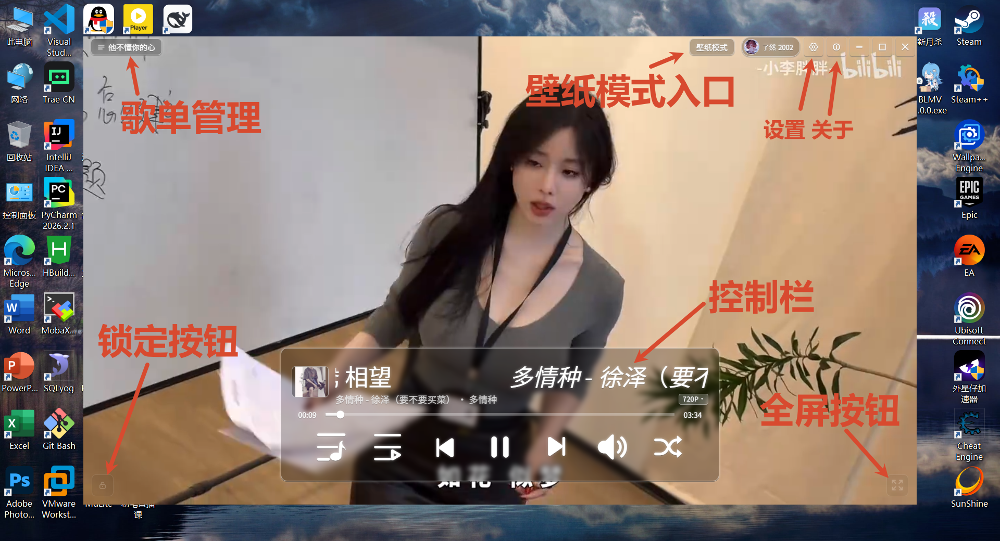
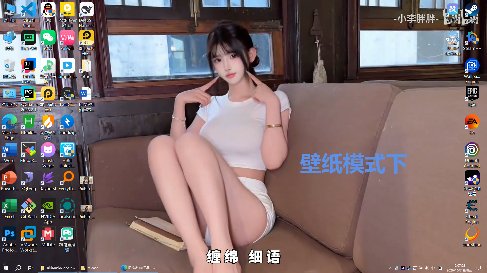
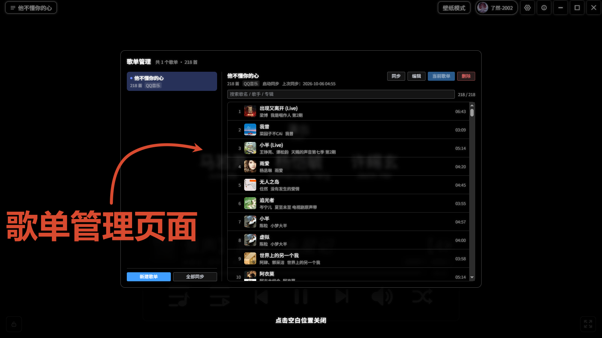
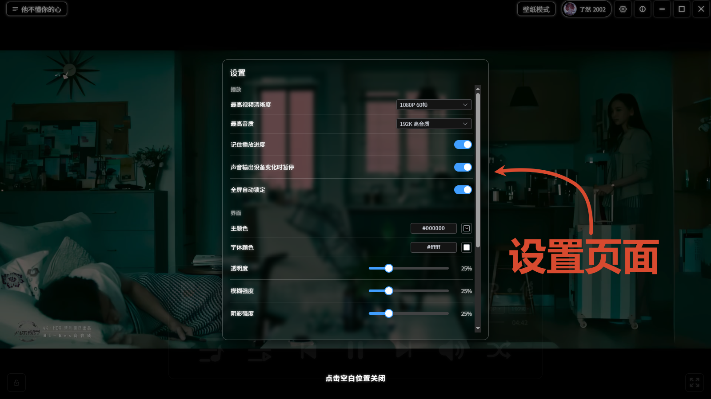
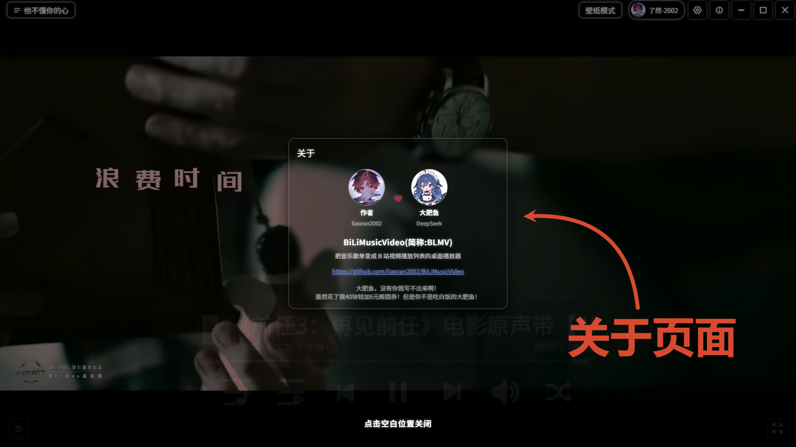

# BLMV · B站音乐视频桌面播放器

**把音乐歌单变成 B 站视频播放列表的桌面播放器。**

你在某些音乐平台收藏的歌单，粘个分享链接进来，它会逐首去 B 站找最像原曲的那个视频并播放；也能整个嵌进桌面壁纸层，当一块会唱歌的「动态壁纸」。
无边框 + 毛玻璃界面，颜色、透明度、模糊、阴影都能自己调。

> 名字：**BLMV** = **B**i**L**i**M**usic**V**ideo

<p>
  
  
  
  
</p>

---

## 目录

- [软件截图](#%E8%BD%AF%E4%BB%B6%E6%88%AA%E5%9B%BE)
- [功能特性](#%E5%8A%9F%E8%83%BD%E7%89%B9%E6%80%A7)
- [技术栈](#%E6%8A%80%E6%9C%AF%E6%A0%88)
- [快速开始](#%E5%BF%AB%E9%80%9F%E5%BC%80%E5%A7%8B)
- [使用说明](#%E4%BD%BF%E7%94%A8%E8%AF%B4%E6%98%8E)
- [配置文件位置](#%E9%85%8D%E7%BD%AE%E6%96%87%E4%BB%B6%E4%BD%8D%E7%BD%AE)
- [常见问题](#%E5%B8%B8%E8%A7%81%E9%97%AE%E9%A2%98)
- [实现笔记](ARCHITECTURE.md)（架构 / 数据流 / 踩坑记录，改代码再看）
- [文件职责与实现逻辑](FILES.md)（每个文件负责什么、每项功能怎么实现的）
- [Android 手机 / TV 端方案](ANDROID-PLAN.md)（调研存档，**未实施** —— 路线、复用清单、工作量）
- [免责声明](#%E5%85%8D%E8%B4%A3%E5%A3%B0%E6%98%8E) · [许可证](#%E8%AE%B8%E5%8F%AF%E8%AF%81)

## 软件截图








## 功能特性

### 歌单：从音乐平台到 B 站视频

- **多平台歌单导入**：粘贴 **某些音乐平台** 的歌单分享链接即可，
  自动识别平台、解析出完整曲目（歌名 / 歌手 / 专辑 / 封面 / 时长）。
- **多歌单管理**：想建几个歌单都行，各自记住「播放到第几首」；可新建 / 编辑名称 / 删除。
- **曲目浏览与搜索**：歌单管理弹窗右侧就是曲目表，每首带封面、歌名、歌手、专辑、时长，
  支持按 **歌名 / 歌手 / 专辑** 实时过滤；点任意一首立刻切过去播。
- **自动同步**：每个歌单可以设「手动同步 / 每次启动同步 / 定时同步」（30 分钟、1 / 3 / 6 / 12 小时、每天、每 3 天、每周），
  也能随时手动同步单个歌单或全部歌单。同步会自动补新歌、去重、清掉已下架的曲目，
  并把「播放到第几首」按歌重新定位（曲目增删后不会指到别的歌上）。
- **手动建歌单也行**：新建时可以不粘分享链接，直接在文本框里**按行填「歌名-歌手」**；
  这类手填曲目不参与自动同步（没有来源链接），但照样走 B 站搜索匹配。
- **智能匹配 + 记忆**：先**硬过滤**，再**打分排序**。
  - **硬过滤**（三条任一命中就丢）：① 标题里歌名必须**独立出现** ——
    标题里 `《…》` 的内容**等于**歌名就算通过（书名号是最强信号，而且**只用来放行**：
    它也可能指电视剧名，比如 `【许茹芸】泪海（《真爱一世情》电视剧主题曲）` 里的书名号是剧名）；
    否则要求歌名前后是符号 / 空格（这样 `童话镇`、`红颜旧`、`旧梦一场` 这类**别的歌**会被挡住，
    而 `光良 - 童话`、`童话 光良`、`【罗艺恒】童话` 都留得下）；
    **带空格的歌名**（例如 `伴奏 晴天`）不要求连着出现，拆分后**每个词都在标题里**就算通过；
    ② 视频时长与歌单时长差太多；③ 命中**过滤关键词**。
  - **打分**：**歌手名命中 +100**（这是主断层 —— 「歌手也对」的一批稳定压在最前），
    之后按你配的**关键词加权**逐条累加（`MV` / `官方` / `4K` 加分，`翻唱` / `伴奏` / `教学` 减分）。
    加权**没有分值上限**：给「伴奏」配 `-50` 就是 `-50`，不会被夹回 `-10`。
  - **简繁自动归一**：B 站标题大量用繁体，所以比对前会统一转成简体 ——
    搜《旧》能匹配到 `不夠 - 舊『…』`（它确实就是你要的那首），
    而 `红颜旧` 依然会被挡住。
  - **五轮搜索词递进**（结果不够就换词再搜一轮）：
    `歌名 歌曲 歌手`（全站）→ 同上（音乐区）→ `歌名 歌曲 歌手 MV`
    → `歌名 歌曲 歌手 <歌名以外的那部分>` → `歌名 歌曲`（**去掉歌手名**）。
    前两轮是**同一句话换个分区**（全站 / 音乐区的结果几乎不重叠，各搜一轮取并集）；
    倒数第二轮拿**括号部分**当关键词（歌名没括号时退回 `可视化`），
    为的是捞到「动态歌词排版 / 饭制 / MV」这类标题里不写正名的视频；
    最后一轮**去掉歌手名**——「歌名 + 一个 B 站上匹配不到的歌手」会让 B 站
    退化成按歌手给一堆无关结果，只有退回纯歌名还能捞到歌。
    形态上歌名后面会缀一个**独立词**「歌曲」，歌手名里的括号换成空格
    （`甲（乙）` → `甲 乙`）。
    举例：`溯(Reverse)feat.马吟吟` 会先用「溯」搜，中间一轮改用
    「Reverse feat.马吟吟」—— 括号里的和括号后面的一起算，都不浪费。
  - 你手动换过的视频会被记住，下次续播精确回到同一个视频。
  - 规则本身可调：设置 → 搜索里能改**过滤关键词**、**关键词加权**（分值可以直接输入，也能用 `+` / `−` 微调）、
    **时长容差**、**降级阈值**。
- **视频列表能自己管**：左上角刷新 = 重新搜索这首歌（也能一键切换成「重新同步歌单」，两种列表共用一个按钮，
  点了转一圈）；行尾**爱心**收藏 / 取消收藏，收藏的视频固定排在最前面、重新搜索也不会丢（按 bvid 去重）；
  右上角**加号**可以粘贴 B 站链接或 BV 号（支持 `b23.tv` 短链）解析出封面标题，确认后直接加到这首歌的收藏第一位。
- **歌单里找歌不用翻**：歌曲列表右上角是个放大镜，点开变搜索框（自动聚焦），
  按 **歌名 / 歌手 / 专辑** 实时过滤、标题旁显示「命中 / 总数」；
  点了结果里的某首歌就播放它，并自动清空搜索框、收回放大镜。

### ▶️ 播放：能拿到多高就多高

- **高清不将就**：能播 **1080P60 / 4K / 8K** 以及 **Hi-Res / 杜比全景声** 音质；
  拿不到高清时自动退回 720P，不会让你看不了。
- **清晰度 / 音质随手切**：控制栏歌曲名下面就是「清晰度」「音质」两个角标，
  点开是**当前这个视频真正能选的**档位（选不了的不会列出来）。
  平时切换是**瞬间完成**的，不用重新联网。
  **只作用于当前这首歌**，下一首自动回到设置里的默认上限。
- **切歌几乎无感**：播放时会提前把**上一首和下一首**都准备好，快播完时还会把它们开头两秒拉起来，
  所以切歌通常 0.3~0.9 秒就出画，中间不会弹那个缓冲进度环（真慢的时候它照样会出来告诉你情况）。
- **缓冲百分比**：切清晰度、切歌、拖进度都要重新缓冲，界面中间会给出真实进度环和百分比，不会让你以为卡死了。
- **播放模式**：列表循环 / 单曲循环 / 随机播放。
- **自动跳过失效的视频**：播放地址过一段时间会失效，软件会自动换新的；视频真的挂了就跳过下一个。
- **进度记忆**：音量、播放模式、播放进度、看到哪个视频，全部记下来。

### ️ 续播 / 壁纸 / 系统集成

- **记住播放进度**：下次打开自动回到上次的歌单、那首歌、那个视频和播放位置。
  关掉之后仍然回到**上次那一首**（歌单里的 `lastIndex`），只是从 0:00 开始、不再回到上次的秒数。

- **桌面壁纸模式**：一键把播放器嵌进桌面壁纸层（Windows），铺满整个桌面且不进任务栏；
  这时候**标题栏和控制栏都会隐藏**，已经打开的列表 / 歌单管理 / 设置也会自动收起来，
  桌面就是一块纯背景，操作全部走托盘菜单；退出时按进入前的状态还原
  （全屏回全屏、最大化回最大化、普通窗口回原尺寸）。

- **系统媒体控件（Windows SMTC）**：歌曲名 / 歌手 / 专辑 / **封面** 会同步到系统媒体浮层与锁屏，
  键盘上的媒体键（播放暂停 / 上下曲 / 快进快退）直接可控。

- **系统托盘**：**右键是个迷你控制台** —— 当前歌曲（`歌名 - 歌手名`）、可拖动的进度条、
  `已播 / 总时长`，以及「音量（悬停出条，**悬停时滚轮 ±5**）· 上一首 · 播放暂停 · 下一首 · 模式切换」五个按钮，
  下面是 设置歌单 / 定时 / 壁纸模式（窗口藏起来时显示「恢复窗口」）/ 退出登录 / 退出程序，
  文字统一居中。设了定时后「定时」那一项直接显示倒计时（**蓝字**），归零时变**红字** `00:00`。
  **左键直接显示窗口，并且顺手解锁界面**；壁纸模式下它是唯一入口，所以点「设置歌单」「定时」
  都会先切回窗口模式再打开对应面板。

- **关闭到托盘**（设置 → 通用）：点关闭按钮不退出，最小化到托盘继续放，托盘菜单里那一项会变成「恢复窗口」。

- **定时暂停 / 定时关闭**（标题栏「定时」按钮）：设一个时长（时 + 分，**可以直接打字，也能用 `+` / `−` 微调**），
  到点后**停止播放**；勾了「停止播放后关闭程序」就**退出应用**。三个选项可以叠加：

  | 选项 | 作用 |
  | :--- | :--- |
  | 暂停时停止倒计时 | 视频暂停 → 倒计时**冻结**，恢复播放才继续走 |
  | 视频播放完毕后停止播放 | 到点不立刻停，等**某个视频播到第 0-3 秒**再执行（不会把你正听的掐断） |
  | 停止播放后关闭程序 | 把「停止播放」升级成「关闭程序」 |

  设了时长后按钮变成倒计时（有小时 `1:23:45`、没有 `23:45`）；
  **倒计时归零、正在等视频播完**时显示红色的 `00:00`。
  再点按钮可以「更新定时」或「取消定时」。时长和三个选项都会记住，下次打开直接显示上次的值。

- **卡顿自动恢复**：播放位置连续 8 秒没前进就算卡顿，按**分级**恢复：

  ```
  ① 换同一个清晰度的另一条线路（同一个视频通常有好几条线）
  ② 都试完还卡 → 降一档清晰度（最多降 3 档）
  ③ 降到底还卡 → 降到 720P
  ④ 还卡 → 暂停播放 + 提示「请检查网络状况」
  ```

  **换线路和降到 720P 是无条件自动做的**（不损失清晰度）；
  「降清晰度」由设置里的 **「卡顿自动降低清晰度」** 控制（默认**关**）：
  打开就自动降并提示「已自动降低清晰度为 XXX」，关着则只提示「建议降到 XXX」让你自己决定。

- **任务栏播放进度**（设置 → 通用）：任务栏图标上直接显示当前视频放到哪了，暂停时会变成「已暂停」样式。

- **输出设备变化自动暂停**（设置 → 播放）：插拔耳机 / 切换默认扬声器时会先暂停，避免声音跑到别的设备上。

- **账号登录**：内置 B 站登录窗口，登录后能拿到更高清晰度与会员音质；
  Cookie 持久化，重启不用重登，登录态变化会自动用新权限重新解析。

- **快捷键**：`空格` 播放暂停 · `↑ ↓` 音量 · `← →` 快进退 5 秒 · `F` 全屏 · `Esc` 退出全屏 · `S` 锁定 / 解锁界面。
  另外**音量按钮悬停时滚轮也能调音量**（上滚 +5、下滚 −5，和 `↑ ↓` 同一步长），控制栏和托盘菜单里都支持。
  两个例外：**壁纸模式下所有快捷键都不响应**（操作全走托盘），**有弹窗打开时 `S` 不生效**（弹窗里可能在打字）。

- **界面锁定**：左下角那个锁按钮（或按 `S`）会把标题栏、控制栏、歌单入口全收起来，
  只留左下（锁定）和右下（全屏）两个按钮 —— 想安静看画面时用；
  再点一次或再按 `S` 解锁（锁定/解锁都会弹一条提示），**左键点托盘图标也能解锁**。设置 → 播放里的
  \*\*「全屏自动锁定」\*\*默认关闭，打开后一进全屏就自动锁上、退出全屏自动解开。

### 界面：能自己调的那种

- **无边框 + 毛玻璃**：自定义标题栏、控制栏、弹窗、歌单面板统一一套玻璃质感，
  弹窗点空白处即关（遮罩上有「点击空白位置关闭」提示）。
  设置页里的横线分两级粗细：**设置项之间**的线更明显，**同一块里的细分**（四个滑块、
  各分值档之间）用更淡的细线 —— 一屏那么多线，不分层级会看得很乱。
- **外观自定义**（设置 → 界面）：
  - **主题色**：玻璃底的底色，`#RRGGBB` 输入框 + 取色盘
  - **字体颜色**：所有压在视频上的文字
  - **透明度**：玻璃底有多透
  - **控制栏闲置透明度**：鼠标不悬停时控制栏淡到多透明（0-100%，五步一进）；
    移上去会恢复完全不透明。默认 10% —— 和「透明度」分开是有意的：
    那个管**玻璃底**，这个管**整块控件**的淡出
  - **模糊强度 / 阴影强度**：毛玻璃的模糊半径与文字阴影大小（界面按百分比、5% 一档）
    深浅不用自己选：调完颜色会按底色亮度自动决定用黑阴影还是白阴影、弹窗控件用亮色还是暗色。
  - **窗口宽高比**：`16:9（默认）` / `4:3` / `不限制`，
    也能**直接输入**任意比例（如 `21:9`、`9:16` 竖屏），输入过的会自动记进下拉列表。
    窗口初始尺寸取「屏幕可用宽度的 80%」，并且会保证不超出屏幕
    （比如选 9:16 竖屏时，会按高度缩回来而不是把窗口顶出屏幕）。
- **开机自动启动**（设置 → 通用）：想让播放器常驻就打开它，下次开机自动拉起。
  默认**关**（不替你改系统启动项）。便携版注册的是**当前 exe 的位置**，
  所以把文件夹挪走之后要**重新开关一次**（每次启动应用也会自动重写一遍来纠正）。
- **清晰度上限**（设置 → 播放）：自动播放时最高选到哪一档清晰度 / 音质，铺的是完整档位表。
- **缓存管理**：设置里能看到播放地址缓存占用，可设置「搜索结果过期时间」（**0 = 永久**），
  以及「清理过期」与「全部清除」。**收藏和视频标题封面永不过期**，过期的只有播放地址。
- **关于**：标题栏有「关于」入口，仓库地址一点就用系统浏览器打开。
- **绿色便携**：免安装版数据可以跟着程序走（见 [配置文件位置](#%E9%85%8D%E7%BD%AE%E6%96%87%E4%BB%B6%E4%BD%8D%E7%BD%AE)）。

### ⚙️ 设置项一览

设置弹窗是**左侧目录 + 右侧一页到底**：左栏（播放 / 界面 / 通用 / 搜索）点一下会
**平滑滚到对应位置**，高亮跟着滚动走 —— 不是切换页面，所有设置始终在同一页里。
除特别说明外**改完立刻生效并落盘**：

| 分组 | 设置项 | 默认 | 说明 |
| :--- | :--- | :--- | :--- |
| 播放 | 最高视频清晰度 | 1080P 60帧 | 自动播放时的上限，实际按登录态/会员/视频可用档位降级 |
| 播放 | 最高音质 | 192K | 同上；角标里能选当前视频实际可用的档位 |
| 播放 | 记住播放进度 | 开 | 下次打开回到上次的歌单 / 歌曲 / 视频 / 播放位置 |
| 播放 | 声音输出设备变化时暂停 | 开 | 插拔耳机、切默认设备时暂停，避免声音跑到新设备 |
| 播放 | 全屏自动锁定 | 关 | 进全屏时自动收起界面（标题栏 + 控制栏），退出全屏解开 |
| 播放 | **卡顿自动降低清晰度** | **关** | 卡顿 8 秒后的分级恢复里，**只有「降清晰度」这一步**受它控制。**换线路 / 降到 720P 始终自动做**（不损失清晰度）。开着就自动降并提示，关着只提示「建议降到 XXX」 |
| 界面 | 主题色 | `#000000` | 玻璃底色，取色盘或手输 `#RRGGBB` |
| 界面 | 字体颜色 | `#FFFFFF` | 压在视频上的所有文字 |
| 界面 | 透明度 | 30% | 玻璃底有多透（**底色**的属性，悬停前后都一样） |
| 界面 | 控制栏闲置透明度 | 10% | 鼠标**不悬停**时整个控制栏淡到多透明；移上去恢复完全不透明。**0-100%，五步一进**。和「透明度」不是一回事：那个管玻璃底，这个管整块控件 |
| 界面 | 模糊强度 | 50% | 毛玻璃的模糊半径（5% 一档） |
| 界面 | 阴影强度 | 40% | 文字阴影模糊半径（5% 一档） |
| 界面 | 窗口宽高比 | 16:9 | `16:9` / `4:3` / `不限制`，也可手输任意比例（如 `21:9`）；输入过的会进下拉列表。壁纸模式下不生效 |
| 通用 | 启动时进入桌面壁纸模式 | 关 | **只管下次开机**；打开时不会立刻进壁纸（当前是否壁纸用标题栏按钮 / 托盘切） |
| 通用 | 开机自动启动 | 关 | 写进系统启动项，下次开机自动拉起。**默认关**（改启动项该由你自己打开）。便携版注册的是**当前 exe 路径**，所以**挪动程序位置后要重新开一次**（每次启动应用会自动重写来纠正） |
| 通用 | 关闭窗口时最小化到托盘 | 关 | 关掉就保持「点 X 就退出」的习惯 |
| 通用 | 任务栏显示播放进度 | 开 | 任务栏图标上画播放进度条 |
| 通用 | 搜索结果过期时间 | 3 天 | **数字输入框（带加减按钮）**，单位「天」；**0 = 永久**（不清理播放地址）。过期只清播放地址，**收藏和标题封面永不过期** |
| — | 搜索缓存 | 开 / 3 天 | 这一行**只有开关以外的信息**：显示占用 + 「清理过期」/「全部清除」两个按钮（`cache.enable` 没有界面）。「全部清除」= 收藏、选中视频、播放地址一起清掉 |
| 搜索 | 时长容差 | 300 秒 | 视频时长与歌单时长差超过它就丢掉（那多半不是同一首歌：合集、live 全场、串烧）。上限受它控制；**下限**取 `max(歌长−容差, 歌长×0.3)`，所以容差很大时下限由那个系数兜底。标题含 `MV / 官方 / Live / 现场` 时上限再放宽 ×1.7 |
| 搜索 | 降级重搜阈值 | 30 条 | 过滤后少于这么多条就**换词重搜**（`歌名 歌曲 歌手` 全站 → `歌名 歌曲 歌手` 音乐区 → `+MV` → `+<歌名以外的那部分>` → `歌名 歌曲`（去掉歌手））。**0 = 从不降级**（只搜一次） |
| 搜索 | 关键词加权 | 见下 | 打分阶段的加减分。**歌手名命中先给 +100**（主断层），之后这些加权**逐条累加、没有上限** —— 给「伴奏」配 `-50` 就是 `-50`。每档分值可以**直接打字输入**，`+` / `−` 微调；删除一档要二次确认。⚠️ 这里**不要放已经出现在「过滤关键词」里的词** —— 那些视频在打分之前就被丢掉了，档位永远不生效 |
| 搜索 | 过滤关键词 | 21 个谱类词 | 命中**直接丢弃**（不是降权）。默认是吉他谱 / 钢琴谱 / 简谱 / 五线谱 / 指弹 / 演奏 / 口琴 / 萨克斯…… 可自己增删 |
| — | 恢复默认设置 | — | 一键还原上面所有项 |

**「关键词加权」和「过滤关键词」的区别**（界面上是分开的两块）：

|  | 关键词加权 | 过滤关键词 |
| :--- | :--- | :--- |
| 作用阶段 | **打分**（硬过滤之后） | **硬过滤** |
| 命中后 | 加 / 减分 | **直接丢弃** |
| 是否进入评分 | 是 | 否 |
| 你什么时候用它 | 微调排序偏好 | 绝对不想要的内容 |

默认的加权表（分值 → 关键词）：

| 分值 | 关键词 |
| :--- | :--- |
| **+5** | MV、官方、原唱、4K |
| **+3** | 无损、高清、现场、Live、录音室 |
| **−3** | 翻唱、合唱、歌单、电台 |
| **−5** | 教学、教程、伴奏、消音 |
| **−10** | reaction、纯伴奏、instrumental |

## 技术栈

| 层 | 用了什么 |
| :--- | :--- |
| 桌面壳 | [Electron](https://www.electronjs.org/) 42（无边框窗口；**刻意不用透明窗口**，原因见 [常见问题](#%E5%B8%B8%E8%A7%81%E9%97%AE%E9%A2%98)） |
| 数据 | [better-sqlite3](https://github.com/WiseLibs/better-sqlite3)（SQLite 单库 `blmv.db`；预编译分发，不需要 Rust / 编译） |
| 简繁 | [opencc-js](https://github.com/nk2028/opencc-js)（只引 `t2cn` 子路径，106 KB；B 站标题大量用繁体，比对前统一转简体） |
| 界面 | [Vue 3](https://vuejs.org/) 3.5 + [TypeScript](https://www.typescriptlang.org/) 5.9 + [Pinia](https://pinia.vuejs.org/) 3 + [Element Plus](https://element-plus.org/) 2.14 |
| 构建 | [electron-vite](https://electron-vite.org/) 6（主进程 / preload / 渲染进程三端统一）+ [electron-builder](https://www.electron.build/) 26 |
| 播放 | 自写的高清流播放器，支持音视频分流与多档清晰度 |
| 壁纸 | 使用 [koffi](https://koffi.dev/) 直调 Win32（`electron/main/winWallpaper.ts`） |
| 图标 | [iconfont](https://www.iconfont.cn/) 字体图标 |

架构、数据流、类型链路、踩坑记录都在 → **[ARCHITECTURE.md](ARCHITECTURE.md)**
每个文件的职责与各项功能的实现逻辑 → **[FILES.md](FILES.md)**

## 快速开始

```bash
# 安装依赖（建议 Node 20+）
npm install

# 开发模式（electron-vite 同时起渲染进程 HMR 与 Electron）
npm run dev

# 壁纸模式开发（启动后直接嵌入桌面）
npm run dev:wall

# 类型检查（主进程 + 渲染进程）
npm run typecheck

# 构建产物到 out/（明文，开发/调试用）
npm run build

# 构建 + 保护（V8 字节码 / 混淆 / 资源加密，见下面「打包与代码保护」）
npm run build:protected

# 只跑保护那一步（注意：产物已经是保护状态时会自动跳过）
npm run protect

# 免安装目录（release/win-unpacked，不生成安装包，调试打包问题最快）
npm run pack

# 打包（NSIS 安装包 + 免安装便携版，产物在 release/）
npm run dist
```

> 开发（`npm run dev`）**不会**触发保护，渲染层走 Vite dev server，改完刷新即可；
> 保护只在 `pack` / `dist` 里跑，而且是**就地改写 `out/`** ——
> 跑完 `pack` / `dist` 之后 `out/` 里是密文与字节码，**想继续调试先 `npm run build:only` 还原成明文**。
>
> `protect` 会先检查 `out/` 是不是干净的明文：只要发现字节码 / 密文的痕迹就**直接报错**
> 让你先 `npm run build:only`，不会在混合态上闷头再处理一遍。
> （历史坑：原地改写时若发生一次部分重建，就会留下「主进程明文 + 渲染层密文」的混合态，
> 页面把密文当 HTML 渲染 → **满屏乱码**。现在由这个前置检查挡住。）
>
> 另外 `ELECTRON_RUN_AS_NODE` 被设成 `1` 的环境（某些 CI / 终端）会让 `electron` 退化成纯 Node，
> 表现为 `app.setName` 未定义、或打包时报 `bad option: --no-sandbox` —— 跑脚本前清掉这个变量。

> esbuild 的子进程在受限环境里可能被拦（`spawn EPERM`），那属于沙箱限制，不是项目问题 ——
> 在普通终端里跑就好。
>
> 壁纸模式由 `koffi`（预编译的 N-API 包）直调 Win32 实现，
> `npm install` 即可用。

## 使用说明

 1. **添加歌单**：点左上角歌单名 → 打开「歌单管理」→ 新建歌单 → 粘贴音乐平台的歌单分享链接；
    不想粘链接也行，直接在文本框里**按行填「歌名-歌手」**（这类曲目不参与自动同步）。
    首次启动没有任何歌单时，会**自动打开「歌单管理」弹窗**（点里面的「新建歌单」开始）。
 2. **开始播放**：在曲目表里点任意一首即可；之后底部控制栏的上一首 / 下一首就顺着这个歌单走。
 3. **换视频**：控制栏第一个图标是「歌曲列表」、第二个是「视频列表」；
    视频列表里是这首歌词条 B 站搜索结果，点一条就换成它播（会记住，续播时还用它）。
 4. **切清晰度 / 音质**：点歌曲名那行右侧的「清晰度」「音质」角标；
    设置里的「最高清晰度 / 最高音质」是自动播放时的上限，角标里是当前视频实际能选的档位。
 5. **同步歌单**：在歌单管理里点某个歌单的同步按钮，或设置「每次启动 / 定时同步」。
 6. **续播**：默认开启，下次打开回到上次的位置；不想要就在「设置 → 播放」里关。
 7. **登录 B 站**：点右上角头像 → 弹出登录窗口扫码 / 登录，登录后自动用更高清晰度与音质。
 8. **桌面壁纸模式**：点右上角「壁纸模式」，再点一次（此时按钮显示「**窗口模式**」）恢复窗口；
    壁纸模式下没有任务栏按钮，回窗口也可以左键点托盘图标，或右键菜单里的「窗口模式」。
 9. **外观**：设置 → 界面，主题色 / 字体颜色 / 透明度 / 模糊强度 / 阴影强度随你调。
10. **锁定界面**：点左下角的锁按钮（或按 `S`），标题栏和控制栏会收起来、只留左下右下两个角按钮；
    再点一次解锁。想一进全屏就自动锁，去「设置 → 播放」打开「全屏自动锁定」。
    **锁着的时候左键点一下托盘图标也能解锁**（全屏/壁纸模式下同样有效）。
11. **定时暂停 / 定时关闭**：点右上角的「**定时**」按钮 → 设好时和分（可以直接打字）→ 按需勾选三个选项 → 确认。
    按钮随后变成倒计时；再点它可以选择「更新定时」或「取消定时」。
    到点后默认**只停止播放**，勾了「停止播放后关闭程序」才会退出应用。

## 配置文件位置

数据默认都在 `%APPDATA%/BiLiMusicVideo/`：

> 目录名来自 `package.json` 的 `name`（`BiLiMusicVideo`）—— Electron 的
> `app.getPath('userData')` 就是 `%APPDATA%/<name>`。
> （`build.productName` 是 `BLMV`，但那是 electron-builder 的字段，Electron 不读它。）

| 内容 | 文件 |
| :--- | :--- |
| **歌单、曲目、候选视频、收藏、上次播的视频** | **`blmv.db`**（SQLite 单库） |
| 应用配置（清晰度上限、界面颜色、续播位置……） | `setting.json` |
| 播放地址缓存 | 在 `blmv.db` 里（**默认 3 天过期**，过期只清地址、不删收藏；设置里可改，**0 = 永久**） |

**免安装（便携）版**按下面的优先级选数据目录：

| 情况 | 用哪个目录 |
| :--- | :--- |
| `%APPDATA%/BiLiMusicVideo` 里**已经有数据** | 就用它（安装版 / 便携版共用一份，换版本不会「数据不见了」） |
| 没有数据，且当前是便携版（有 `PORTABLE_EXECUTABLE_DIR`） | exe 同级的 **`blmvdata/`**（自动创建，数据跟着程序走） |
| 没有数据，且是安装版（全新环境） | 默认的 `%APPDATA%/BiLiMusicVideo` |

> 目录名用 `blmvdata` 而不是通用的 `data`，是为了和别的软件区分开 ——
> 绿色版经常被丢在同一个文件夹里，`data/` 这么通用的名字很容易撞。
>
> **判断「有没有数据」会看 `blmv.db`**，所以只带一个库文件也能被正确识别成便携数据目录。

想彻底干净地试用：把 `%APPDATA%/BiLiMusicVideo` 整个删掉，然后把免安装版丢进一个空文件夹里运行，
它就会在那个文件夹里建 `blmvdata/`，所有数据都在那儿。

## 常见问题

**Q：为什么清晰度只有 720P？**

```
高清（1080P60 / 4K / 8K）能不能拿到，取决于**两件事**：

① 这个视频本身有没有高清版本 —— 有些老视频、转载的就只有 720P；
② 你的账号权限够不够 —— 没登录 / 没大会员时，B 站不会给你高清地址。

两样都满足时软件会自动用最高档。如果明明有大屏会员却还是 720P，
点一下清晰度角标手动选一次看看列表里有没有更高档。
```

**Q：登录了清晰度还是没变？**

```
登录后会自动重新取一次播放地址（不用重启）。
如果当前这首歌还是旧档位，点一下角标手动选一次即可。
```

**Q：我在控制栏把清晰度调成 360P，为什么下一首变回 1080P 了？**

```
这是故意的：角标里的选择**只作用于当前这首歌**（临时试一下 / 这视频只有这个档位），
下一首会回到设置里的默认上限。想永久改就去「设置 → 播放 → 最高视频清晰度」。
```

**Q：进壁纸模式后怎么回到窗口？**

```
壁纸模式是「把窗口嵌到桌面图标层下面」，这时**任务栏上不会有它的按钮**（和最小化到托盘一样干净），
标题栏和控制栏也隐藏了，所以操作全在托盘上：
① 左键单击托盘图标 = 直接回到窗口模式并显示窗口；
② 右键菜单里点「窗口模式」也一样。

这两条路都很稳：它们不只看状态标志，还会直接问系统「窗口是不是真的还挂在桌面壁纸层」，
是就摘下来 —— 所以即使状态异常也不会「回不来」，不需要去杀进程或重启资源管理器。
```

**Q：点了「壁纸模式」没反应 / 提示不可用？**

```
壁纸模式依赖 Windows 的桌面层结构（Progman / WorkerW）。如果原生层初始化失败，
现在会明确告诉你原因（以前是完全静默的，点了没反应也没有任何日志）：
- 「当前平台不支持壁纸模式」→ 不是 Windows，或不在 Windows 上跑；
- 「找不到桌面壁纸层（WorkerW）」→ 资源管理器（explorer.exe）没在运行，或桌面被第三方工具接管；
- 「原生模块不可用」→ koffi 没装上，重新 `npm install` 即可（**不需要 Rust**）。
另外注意：某些「动态壁纸」软件会占用桌面层，和壁纸模式互斥。
```

**Q：壁纸模式下「有声音、但画面是黑的 / 不动」？**

```
这是「透明窗口 + 没有 GPU 加速」的组合导致的，已经修掉了（v1.0.0 之后）。
简单说：透明窗口在拿不到 GPU 加速时会退回 GDI「分层窗口」实现，
而分层窗口挂到桌面壁纸层之后画不出来 —— 音频走独立线程，所以声音照旧。

**哪些环境会没有 GPU 加速**（都比想象的常见）：
- 虚拟机（VMware / VirtualBox 没开「3D 加速」）
- 远程桌面（RDP）会话
- 显卡驱动没装好 / 用的是「Microsoft 基本显示适配器」
- 老显卡，或启动时带了 --disable-gpu

修法是**主窗口不再用透明窗口**（界面上的毛玻璃不受影响，它模糊的是窗口内部的视频画面）。
如果你用的还是旧版本，升级即可；想自己确认，可以在启动参数里加 --enable-logging，
控制台里若出现 exstyle=...layered=1 就说明踩中了这个坑。
```

**Q：切歌时提示「切歌太快了」？**

```
说明你切得太频繁了，B 站暂时不回应搜索了。等一两分钟再播就好，
这不是软件坏了，也不会封号。

避免办法：别连续狂点上一首 / 下一首。

软件也会帮你兜着：正在加载的时候，「上一首 / 下一首」和清晰度 / 音质
会暂时点不动，旁边会给一句「正在加载中」的提示 —— 免得你连点。
```

**Q：切歌时提示「未登录」或者「搜索失败」？**

```
- 提示登录 → 点右上角头像登录后再试。
  没登录时 B 站只放出一部分搜索结果，很多歌是搜不到的。
- 提示「搜索失败」→ 检查一下本机网络 / 代理 / VPN。

另外：**没搜到结果的歌不会被记成「没有」**。所以网络抖动一下不会让某首歌
「3 天内一直找不到视频」，下次切到它会重新搜。
```

**Q：提示「结果都被过滤掉了」，或者视频列表里少了几个？**

```
这是**过滤规则**在起作用，不是搜索失败。三条规则任一命中就会被丢掉：

① 标题里没有歌名（比如搜《起风了》时标题写「现场版 2023」的）
② 时长和歌单里那首歌差太多（默认容差 300 秒，且下限不低于歌长的 30%；
   合集、live 全场、串烧会超上限）
③ 标题命中「过滤关键词」（默认是一组谱类词：吉他谱、钢琴谱、指弹……）

解决办法在「设置 → 搜索」：
- 觉得砍太多 → 把**时长容差**调大，或删掉几个**过滤关键词**
- 嫌还不够严 → 反过来调小 / 加词
- ⚠️ 改完规则后**已经搜过的歌不会自动变成新结果** ——
  点视频列表左上角的**刷新**按钮重新搜一次

**收藏的视频不受过滤影响** —— 你自己挑的（点收藏、或手动「添加视频」粘进来的）
会一直留在列表最前面，哪怕标题里没有歌名。

「结果都被过滤掉了」和「搜不到（切太快 / 网络问题）」是**两回事**，
提示是分开的，解决办法也完全不同。
```

**Q：为什么经常看到「缓存地址已过期，重新解析」？**

```
B 站给的播放地址有**时效**（大约 2 小时），而软件默认把搜索结果留 3 天 ——
所以隔一阵再听，之前存的地址基本都过期了。这时重新取一次就好，属于正常现象；
不重取反而会拿失效地址去播、报「视频加载失败」。

注意过期的**只有播放地址**：收藏、标题、封面、列表顺序都不会过期。
想少看到这条日志，可以在设置里把「搜索结果过期时间」调小或设成永久。
```

**Q：收藏的视频会丢吗？**

```
不会。收藏**没有过期时间**，「搜索结果过期时间」只清理播放地址，不会动收藏。
只有你主动点设置里的「全部清除」才会把收藏一起清掉（那个按钮就是全清的意思）。
```

**Q：偶尔一打开就卡在 99%（时长显示 0:00）不动，点一下下一首又好了？**

```
那条线路「有数据但不继续来」：画面已经缓冲了一部分（所以进度能算到 99%），
但整体时长一直没确定下来 —— 于是缓冲圈挂在那里撤不掉。
现在有兜底：位置连续 8 秒没前进就算卡顿，按「换线路 → 降清晰度 → 降到 720P」分级恢复，
都不行才会暂停并提示你检查网络（详见上面的「卡顿自动恢复」）。
所以正常情况下你不用手动点下一首了；如果连兜底都救不回来，多半是网络或该视频本身有问题。
```

**Q：删掉缓存会怎样？**

```
只会让下一次搜索重新联网（慢一点点），歌单、配置、续播记录都不受影响。
```

**Q：定时暂停到点了，为什么没有立刻停？**

```
看你有没有勾「视频播放完毕后停止播放」——
勾了的话，倒计时归零只是进入「等待」状态（按钮显示红色 00:00），
要等**某个视频播到第 0-3 秒**才真的停（这样不会把你正听的一首从中间掐断）。
不勾就是归零那一刻立刻停。
```

**Q：定时关闭没关掉程序，只是藏进了托盘？**

```
不会。定时关闭走的是「真退出」，不受「关闭窗口时最小化到托盘」影响。
如果你遇到的是「只停止播放没退出」，那是没勾「停止播放后关闭程序」——
那个选项默认不勾，勾上才会退。
```

**Q：卡顿时为什么先换线路、而不是直接降清晰度？**

```
因为同一个清晰度，B 站通常给了好几条不同的线路。
某条线路卡住时换一条往往立刻就好，画面还是原清晰度、不损失观感；
线路都换完还不行，才考虑降清晰度（那一步默认还要你自己确认）。
```

## 打包与代码保护

`npm run pack`（免安装目录）/ `npm run dist`（安装包）会自动做三层保护，
**开发（`npm run dev`）完全不受影响**：

| 层 | 做什么 |
| :--- | :--- |
| 主进程 / 预加载 | 编译成 **V8 字节码**（`.jsc` + 几百字节加载器），asar 里看不到 JS 源码 |
| 渲染层 JS | **代码混淆**（字符串数组 + 十六进制标识符） |
| 渲染层 html/js/css | **AES-256-GCM 加密**，运行时由主进程经 `blmv://` 协议解密后喂给页面 |

密钥在 `electron/main/bundleKey.ts`（会被编进主进程字节码），打包时可用 `BLMV_BUNDLE_KEY` 覆盖。
老实说：客户端加密只是提高门槛 —— 密钥必须在客户端才能解密，这一步做到的是
「不能直接打开 asar 读源码 / 改一行就跑」，不是「绝对安全」。

改这块时按 `ARCHITECTURE.md` 里那套**字节级验收**来（密文头 `BLMV1`、`.jsc` 是否存在、
加载器大小、以及启动打包后的 exe 看窗口标题能不能出来）。

## 免责声明

- 本项目在 AI 的**广泛协助**下开发，因此仍可能存在细微或不易察觉的问题。若给你带来不便，敬请理解。
- 本仓库及其源代码仅供**个人学习、技术交流与非营利测试使用**。请勿将其用于商业盈利用途。**若因对在线资源的传播、加工或再分发而引发版权纠纷或其他责任，均由使用者自行承担，项目开发者不承担相关责任**。
- 请始终尊重数字版权，并在条件允许时通过官方平台支持正版音乐。
- 本项目为桌面端工具，**所有数据存储在用户本地**，不涉及云端服务，不收集任何用户信息。
- 本程序仅提供歌单解析与对应视频的搜索和播放的**完全本地自动化操作**，**不破解、不修改官方客户端或网页端功能**，也**不提供任何音视频下载功能**。
- 若本程序涉及的任何功能**侵犯了您的合法权益**，**请联系删除**。

## 许可证

[GPL-3.0](LICENSE)

